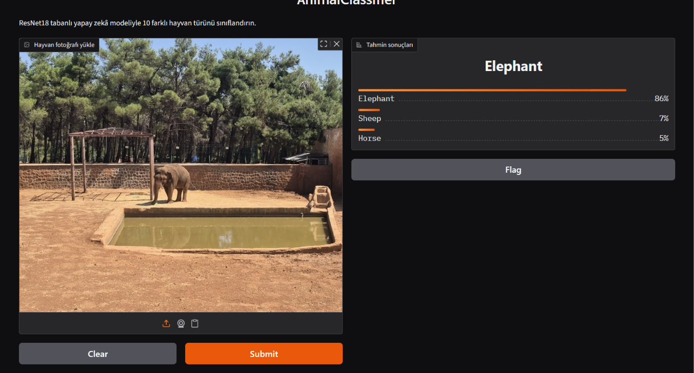
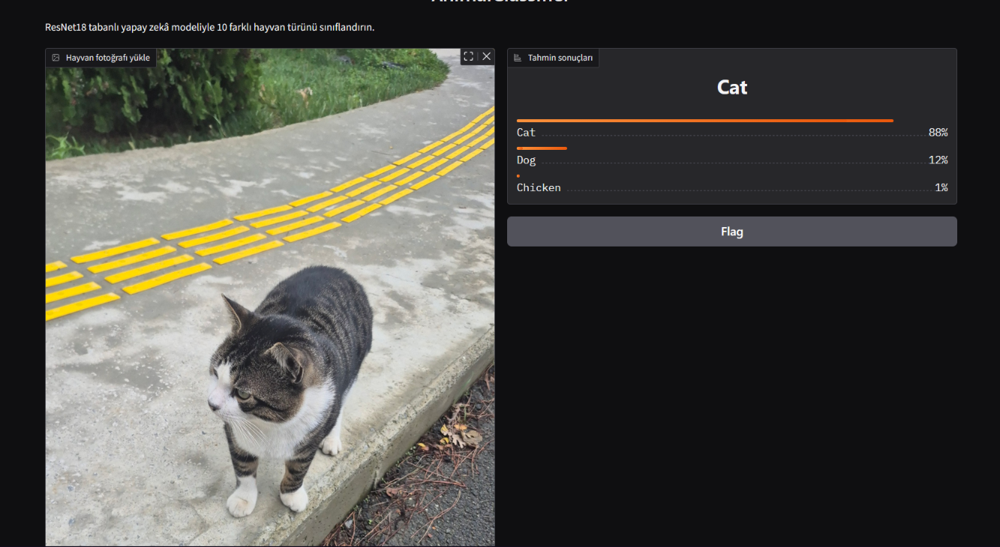
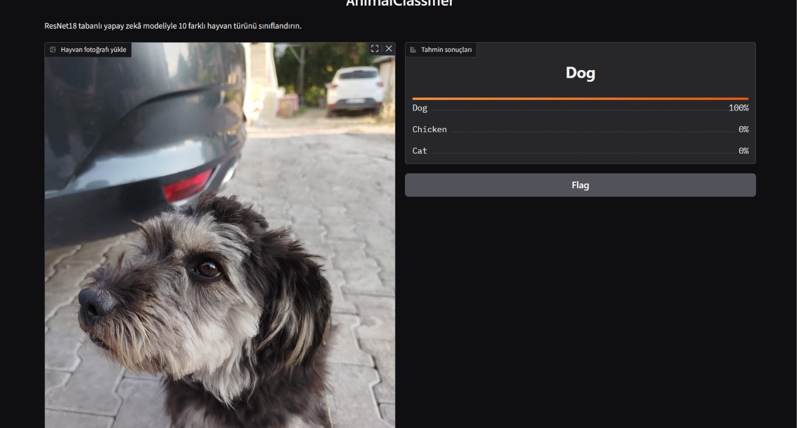
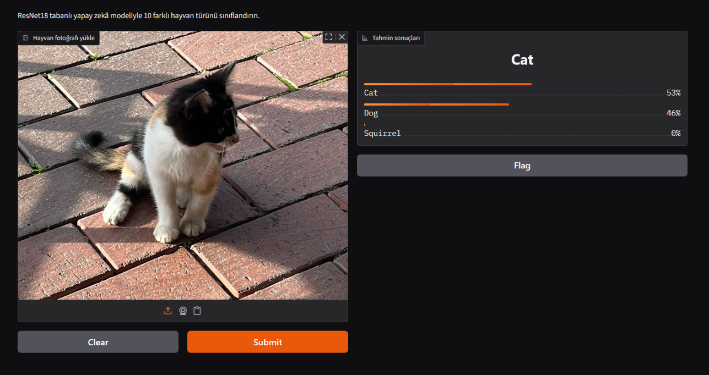
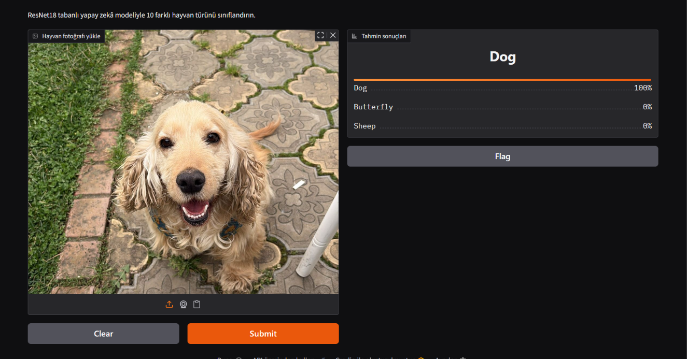

# AnimalClassifier

## COMPUTER VISION – Derin Öğrenme Uygulaması

ResNet18, Transfer Learning, PyTorch ve Gradio kullanılarak geliştirilmiş hayvan görüntüsü sınıflandırma projesi.

---

## 1. Projenin Amacı

Bu projenin amacı, açık kaynaklı bir veri seti kullanarak hayvan görüntülerini 10 farklı sınıfa ayırabilen bir derin öğrenme modeli geliştirmektir.

Geliştirilen modelin performansı bağımsız test verileri üzerinde değerlendirilmiş ve Gradio kullanılarak çalışan bir kullanıcı arayüzü oluşturulmuştur.

## 2. Proje Bilgi Tablosu

| Alan | Öğrenci Yanıtı |
|---|---|
| Project Title | AnimalClassifier – Hayvan Görüntüsü Sınıflandırma |
| Problem / Task | Çok Sınıflı Görüntü Sınıflandırma |
| Dataset | Rapidata/Animals-10 |
| Dataset URL | [Hugging Face – Animals-10](https://huggingface.co/datasets/Rapidata/Animals-10) |
| Model Architecture | ImageNet Pretrained ResNet18 |
| Input Size | 224 × 224 × 3 (RGB) |
| Hyperparameters | Learning Rate: 0.001, Batch Size: 32, Epoch: 5 |
| Optimizer | Adam |
| Activation / Output Function | ReLU, Linear Output, Argmax |
| Loss Function | CrossEntropyLoss |
| Evaluation Metrics | Accuracy, Precision, Recall, F1-score |
| Training Environment | Python 3.11.9, PyTorch 2.14.1+cu126, CUDA 12.6, NVIDIA RTX 4070 Laptop GPU |
| Training Time | 374.8 saniye |
| Best Performance | Validation Accuracy: %96,90 / Test Accuracy: %96,31 |
| Inference Time | 4,84 ms/görüntü |
| Deployment Technology | Gradio |
| Repository | Bu GitHub deposu |

## 3. Veri Seti

Projede Hugging Face platformunda bulunan Rapidata/Animals-10 veri seti kullanılmıştır.

Veri seti toplam 23.554 görüntüden ve 10 farklı hayvan sınıfından oluşmaktadır.

### Veri Seti Dağılımı

| Veri Kümesi | Görüntü Sayısı | Oran |
|---|---:|---:|
| Eğitim (Train) | 18.843 | %80 |
| Doğrulama (Validation) | 2.355 | %10 |
| Test | 2.356 | %10 |
| **Toplam** | **23.554** | **%100** |

Veri seti, sınıfların veri kümelerindeki dağılımını korumak amacıyla Stratified Sampling yöntemiyle bölünmüştür. Yeniden üretilebilirlik için random seed değeri 42 olarak belirlenmiştir.

### Hayvan Sınıfları

- Butterfly (Kelebek)
- Cat (Kedi)
- Chicken (Tavuk)
- Cow (İnek)
- Dog (Köpek)
- Elephant (Fil)
- Horse (At)
- Sheep (Koyun)
- Spider (Örümcek)
- Squirrel (Sincap)

## 4. Model Mimarisi

Projede evrişimli sinir ağı (CNN) tabanlı ResNet18 mimarisi kullanılmıştır.

ImageNet üzerinde önceden eğitilmiş model ağırlıklarından yararlanılarak Transfer Learning yöntemi uygulanmıştır.

Modelin önceden eğitilmiş katmanları dondurulmuş ve 1000 sınıflı orijinal Fully Connected katmanı, 10 hayvan sınıfına uygun şekilde değiştirilmiştir.

Yeni sınıflandırma katmanı 512 giriş özelliğine ve 10 çıkış nöronuna sahiptir.

Yalnızca son sınıflandırma katmanındaki 5.130 parametre eğitilmiştir. Böylece eğitim maliyetinin azaltılması ve önceden öğrenilmiş görsel özelliklerden yararlanılması amaçlanmıştır.

## 5. Görüntü Ön İşleme

Eğitim aşamasında aşağıdaki görüntü dönüşümleri uygulanmıştır:

- RGB renk formatına dönüştürme
- Resize (256)
- RandomResizedCrop (224)
- RandomHorizontalFlip
- ToTensor
- ImageNet Normalization

Doğrulama ve test aşamalarında rastgele kırpma yerine CenterCrop (224) kullanılmış ve yatay çevirme uygulanmamıştır.

Bu işlemler, görüntülerin modele uygun boyuta getirilmesini ve eğitim sırasında veri çeşitliliğinin artırılmasını sağlamaktadır.

## 6. Model Ayarları ve Eğitim

| Hiperparametre | Değer |
|---|---:|
| Learning Rate | 0.001 |
| Batch Size | 32 |
| Epoch | 5 |
| Image Size | 224 × 224 |
| Random Seed | 42 |

Optimizer olarak Adam kullanılmıştır. Adam, adaptif parametre güncellemeleri sayesinde optimizasyon sürecini kolaylaştırmaktadır.

Loss fonksiyonu olarak çok sınıflı sınıflandırma problemlerine uygun olan CrossEntropyLoss tercih edilmiştir.

ResNet18 mimarisinin ara katmanlarında ReLU aktivasyon fonksiyonu kullanılmaktadır.

Çıkış katmanı 10 sınıfa ait ham skorlar (logits) üretmektedir. En yüksek skora sahip sınıf Argmax yöntemiyle belirlenmektedir.

Eğitim sırasında Batch Normalization katmanları değerlendirme modunda tutularak önceden öğrenilmiş istatistikler korunmuştur.

En yüksek validation accuracy değerine sahip model best_model.pth dosyasına kaydedilmiştir.

## 7. Performans Değerlendirmesi

Model, eğitim sürecinde kullanılmayan 2.356 test görüntüsü üzerinde değerlendirilmiştir.

### Genel Performans Sonuçları

| Metrik | Sonuç |
|---|---:|
| Best Validation Accuracy | %96,90 |
| Test Accuracy | %96,31 |
| Macro Precision | %96,21 |
| Macro Recall | %95,54 |
| Macro F1-score | %95,86 |
| Weighted Precision | %96,33 |
| Weighted Recall | %96,31 |
| Weighted F1-score | %96,30 |
| Ortalama Inference Süresi | 4,84 ms/görüntü |

### Sınıf Bazında Performans

| Sınıf | Precision | Recall | F1-score | Support |
|---|---:|---:|---:|---:|
| Butterfly | 0.9689 | 0.9689 | 0.9689 | 161 |
| Cat | 0.9823 | 0.9250 | 0.9528 | 120 |
| Chicken | 0.9609 | 0.9833 | 0.9720 | 300 |
| Cow | 0.9396 | 0.9500 | 0.9448 | 180 |
| Dog | 0.9587 | 0.9647 | 0.9617 | 481 |
| Elephant | 0.9700 | 0.9417 | 0.9557 | 103 |
| Horse | 0.9363 | 0.9615 | 0.9488 | 260 |
| Sheep | 0.9466 | 0.9051 | 0.9254 | 137 |
| Spider | 0.9907 | 0.9816 | 0.9861 | 434 |
| Squirrel | 0.9669 | 0.9722 | 0.9695 | 180 |

Model, test veri setinde %96,31 doğruluk elde etmiştir.

En yüksek F1-score değeri Spider sınıfında, en düşük F1-score değeri ise Sheep sınıfında gözlemlenmiştir.

Tüm sınıfların F1-score değerlerinin %92'nin üzerinde olması, modelin farklı hayvan sınıflarında genel olarak başarılı olduğunu göstermektedir.

### Tahmin Süresi

Tahmin süresi ölçümünde ilk 10 tahmin ısınma (warm-up) amacıyla hariç tutulmuştur.

Sonraki 100 tahminin ortalaması alınarak görüntü başına 4,84 ms model inference süresi elde edilmiştir.

Görüntü ön işleme, cihazlar arası veri aktarımı ve kullanıcı arayüzü işlemleri bu ölçüme dahil edilmemiştir.

## 8. Uygulama (Deployment)

Eğitilen model Gradio kullanılarak çalışan bir kullanıcı arayüzüne dönüştürülmüştür.

Kullanıcı arayüz üzerinden bir hayvan fotoğrafı yükleyebilmekte ve modelin sınıflandırma sonuçlarını güven skorlarıyla birlikte görüntüleyebilmektedir.

## 9. Gerçek Görüntülerle Test ve Değerlendirme

Model, veri seti dışında bulunan beş farklı hayvan fotoğrafıyla Gradio uygulaması üzerinden test edilmiştir.

### Test 1 – Fil

- Gerçek sınıf: Elephant
- Model tahmini: Elephant
- Güven skoru: %86
- Sonuç: Doğru



Hayvanın görüntü içerisinde küçük bir alan kaplamasına rağmen model doğru sınıflandırma yapmıştır.

### Test 2 – Kedi

- Gerçek sınıf: Cat
- Model tahmini: Cat
- Güven skoru: %88
- Sonuç: Doğru



Model, doğal arka plana sahip kedi görüntüsünü doğru sınıflandırmıştır.

### Test 3 – Köpek

- Gerçek sınıf: Dog
- Model tahmini: Dog
- Güven skoru: %100
- Sonuç: Doğru



Hayvanın vücudunun tamamı görünmemesine rağmen model doğru tahmin üretmiştir.

### Test 4 – Kedi

- Gerçek sınıf: Cat
- Model tahmini: Cat
- Güven skoru: %53
- Sonuç: Doğru



Model, kedi ve köpek sınıfları arasında kararsız kalmasına rağmen doğru sınıflandırma yapmıştır.

Görüntünün çekim açısı, ışık koşulları ve hayvanın yüzünün tam görünmemesi tahmin güvenini etkilemiş olabilir.

### Test 5 – Köpek

- Gerçek sınıf: Dog
- Model tahmini: Dog
- Güven skoru: %100
- Sonuç: Doğru



Model, farklı çekim koşullarındaki köpek görüntüsünü yüksek güvenle doğru sınıflandırmıştır.

### Gerçek Görüntü Test Sonuçları

| Test | Gerçek Sınıf | Model Tahmini | Güven Skoru | Sonuç |
|---|---|---|---:|---|
| 1 | Elephant | Elephant | %86 | Doğru |
| 2 | Cat | Cat | %88 | Doğru |
| 3 | Dog | Dog | %100 | Doğru |
| 4 | Cat | Cat | %53 | Doğru |
| 5 | Dog | Dog | %100 | Doğru |

- Toplam test görüntüsü: 5
- Doğru tahmin: 5
- Yanlış tahmin: 0
- Gerçek görüntü test doğruluğu: %100

Beş gerçek görüntünün tamamı doğru sınıflandırılmıştır. Bununla birlikte dördüncü görüntüde modelin sınıflar arasında kararsız kaldığı gözlemlenmiştir.

Test grubunun yalnızca beş görüntüden ve üç hayvan sınıfından oluşması nedeniyle elde edilen %100 doğruluk, modelin genel gerçek yaşam performansını temsil etmemektedir.

## 10. Eğitim Ortamı

| Bileşen | Değer |
|---|---|
| İşletim Sistemi | Windows |
| Python | 3.11.9 |
| PyTorch | 2.14.1+cu126 |
| CUDA | 12.6 |
| GPU | NVIDIA GeForce RTX 4070 Laptop GPU |
| IDE | PyCharm |
| Model Dosyası Boyutu | 42,73 MiB |

## 11. Kurulum ve Kullanım

Gerekli kütüphanelerin kurulması:

```bash
pip install -r requirements.txt
```

Belirtilen bağımlılıklar CUDA 12.6 destekli eğitim ortamını hedeflemektedir. Farklı donanımlar için PyTorch kurulumu uyarlanabilir.

### Gradio Uygulamasını Başlatma

```bash
python app.py
```

### Veri Setini Hazırlama

```bash
python dataset.py
```

### Modeli Eğitme

```bash
python train.py
```

### Model Performansını Değerlendirme

```bash
python evaluate.py
```

Veri seti boyutu nedeniyle GitHub deposuna dahil edilmemiştir. Veri hazırlama kodu kullanılarak yeniden indirilebilir.

## 12. Sonuç ve Değerlendirme

Bu çalışmada ResNet18 mimarisi ve Transfer Learning yöntemi kullanılarak 10 farklı hayvan sınıfını tanıyabilen bir görüntü sınıflandırma modeli geliştirilmiştir.

Model, bağımsız test veri setinde %96,31 doğruluk ve %95,86 Macro F1-score elde etmiştir.

Ortalama 4,84 ms model inference süresi, geliştirilen modelin hızlı tahmin üretebildiğini göstermektedir.

Gradio arayüzü sayesinde eğitilen model kullanıcıların görüntü yükleyerek sınıflandırma sonuçlarını inceleyebildiği çalışan bir uygulamaya dönüştürülmüştür.

Model yalnızca eğitimde kullanılan 10 hayvan sınıfını desteklemektedir. Farklı ışık koşulları, çekim açıları, karmaşık arka planlar ve veri setinde bulunmayan hayvan türleri yanlış veya düşük güvenli tahminlere neden olabilir.

Gelecekte daha fazla hayvan sınıfı, daha çeşitli gerçek yaşam görüntüleri ve farklı model mimarileri kullanılarak uygulama geliştirilebilir.

## 13. Kaynaklar

- [Rapidata Animals-10 Dataset](https://huggingface.co/datasets/Rapidata/Animals-10)
- [PyTorch](https://pytorch.org/)
- [Torchvision](https://docs.pytorch.org/vision/)
- [ResNet – Deep Residual Learning for Image Recognition](https://arxiv.org/abs/1512.03385)
- [Gradio](https://www.gradio.app/)
- [Scikit-learn](https://scikit-learn.org/)

---

Bu proje, Bilgisayarlı Görü dersi kapsamında derin öğrenme ödevi olarak geliştirilmiştir.